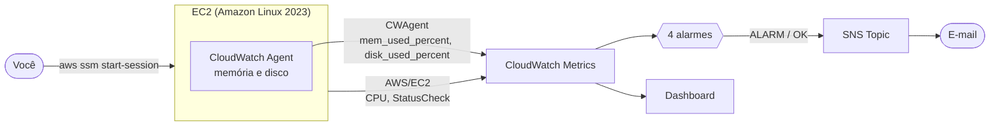

# terraform-monitoring

Monitoramento de EC2 com CloudWatch, alarmes SNS e dashboard via Terraform

> Projeto para aprendizado e portfólio. Antes de usar em produção, revise custos, região e
> requisitos de segurança do seu ambiente.

## Arquitetura



## O que é criado

| Módulo | Recursos |
|---|---|
| `ec2` | Instância Amazon Linux 2023 (AMI via SSM Parameter), IMDSv2, disco criptografado, security group **sem nenhuma porta de entrada**, role com `CloudWatchAgentServerPolicy` + `AmazonSSMManagedInstanceCore`, CloudWatch Agent instalado via `user_data` |
| `sns` | Tópico e inscrição por e-mail |
| `cloudwatch` | 4 alarmes e um dashboard |

### Alarmes

| Alarme | Métrica | Dispara quando |
|---|---|---|
| `<prefixo>-cpu-high` | `AWS/EC2 CPUUtilization` | média > `cpu_threshold` (80%) por 5 min |
| `<prefixo>-status-check-failed` | `AWS/EC2 StatusCheckFailed` | falha por 2 min, ou se a métrica parar de chegar |
| `<prefixo>-memory-high` | `CWAgent mem_used_percent` | média > `memory_threshold` (85%) por 5 min |
| `<prefixo>-disk-high` | `CWAgent disk_used_percent` (`/`) | máximo > `disk_threshold` (85%) |

Todos notificam na entrada em ALARM **e** na volta para OK.

> Memória e disco não são métricas nativas do EC2. Por isso a instância roda o CloudWatch Agent,
> configurado em `modules/ec2/user_data.sh`.

## Pré-requisitos

- [Terraform](https://developer.hashicorp.com/terraform/install) >= 1.5
- AWS CLI configurado
- VPC default existente na região (as contas novas já vêm com ela)

## Como usar

```bash
git clone https://github.com/zHanyaa/terraform-monitoring.git
cd terraform-monitoring

cp terraform.tfvars.example terraform.tfvars
# edite notification_email

terraform init
terraform plan
terraform apply
```

1. **Confirme a inscrição** no e-mail "AWS Notification - Subscription Confirmation". Sem isso, nenhum alarme chega.
2. Abra o dashboard: `terraform output dashboard_url`
3. Após uns 5 minutos, as métricas de memória e disco aparecem no namespace `CWAgent`.

### Testando o alarme de CPU

```bash
$(terraform output -raw ssm_session_command)
# dentro da instância:
sudo dnf install -y stress-ng
stress-ng --cpu 0 --timeout 600s
```

Em uns 5 minutos chega o e-mail de ALARM. Quando o teste acaba, chega o de OK.

### Limpeza

```bash
terraform destroy
```

## Variáveis

| Nome | Padrão | Descrição |
|---|---|---|
| `aws_region` | `us-east-1` | Região AWS |
| `project_name` | `monitoring` | Prefixo dos recursos |
| `environment` | `dev` | Ambiente, usado no prefixo e nas tags |
| `instance_type` | `t3.micro` | Tipo da instância |
| `notification_email` | — (obrigatória) | E-mail dos alarmes |
| `cpu_threshold` | `80` | % de CPU |
| `memory_threshold` | `85` | % de memória |
| `disk_threshold` | `85` | % de disco em `/` |

## Outputs

`instance_id`, `topic_arn`, `alarm_names`, `dashboard_url`, `ssm_session_command`

## CI

O workflow `.github/workflows/terraform.yml` roda `terraform fmt`, `validate`, `tflint` e
`checkov` em cada PR. As exceções do checkov estão em `.checkov.yaml`, cada uma com o motivo.

## Custo estimado

Com `t3.micro`, a instância custa ~US$ 8/mês fora do free tier, mais ~US$ 3,60/mês de IPv4
público. Há ainda o detailed monitoring, 4 alarmes, 3 métricas customizadas e 1 dashboard
(os 3 primeiros dashboards são gratuitos). Destrua quando terminar de estudar.

## Próximos passos

- [ ] Coletar logs do sistema no CloudWatch Logs, com metric filter
- [ ] Alarme composto e integração com Slack/Teams via AWS Chatbot
- [ ] Backend remoto (S3) para o state

## Autor

**Gustavo Pina**: [LinkedIn](https://www.linkedin.com/in/gustavopina-devops/) · [GitHub](https://github.com/zHanyaa)
